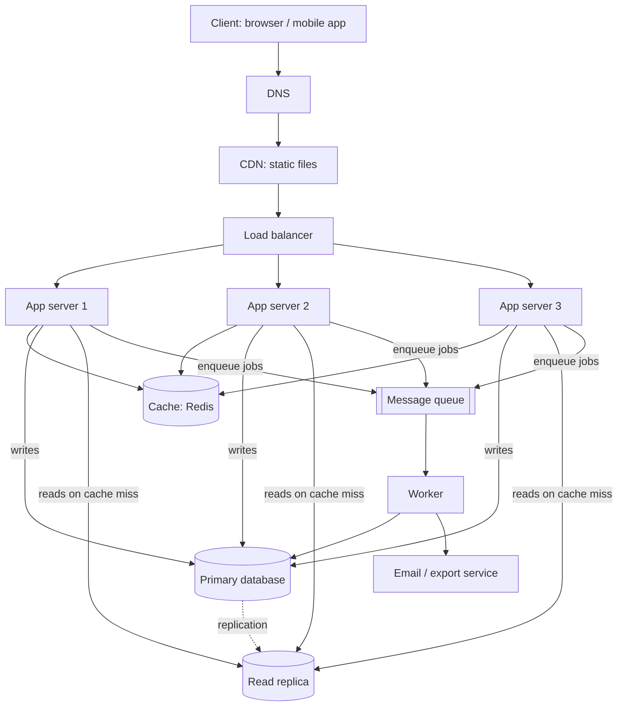

# QuickNotes Architecture

Goal: move QuickNotes from a browser-only app to an online service for **1 million users**.

## Requirements

### Functional

- Sign up, sign in and sign out.
- Create, read, update and delete notes (title up to 100 characters).
- Tag notes and filter by tag.
- See notes from any device.
- Receive a background email when a note is shared or an export is ready (handled by the queue and worker).

### Non-functional

- **Availability:** 99.9% uptime (about 8.8 hours of downtime per year at most).
- **Latency:** p95 under 300 ms for `GET /notes` and `POST /notes`.
- **Durability:** no acknowledged note is ever lost; daily backups plus replication.
- **Scalability:** handle 5x normal traffic at peak by adding servers, not rewriting code.
- **Security:** HTTPS everywhere, hashed passwords, per-user data isolation.
- **Consistency:** a user sees their own writes immediately; other views may lag by seconds.

## Load estimate (1 million users)

Assumptions: 30% of users are active each day (300,000 daily active users, DAU); each active user reads notes 20 times and creates or edits 5 notes per day; an average note is about 1 KB including metadata.

| Quantity                        | Calculation        | Result                                                    |
| ------------------------------- | ------------------ | --------------------------------------------------------- |
| Reads per day                   | 300,000 × 20       | 6,000,000                                                 |
| **Reads per second (average)**  | 6,000,000 ÷ 86,400 | **about 70/s**                                            |
| Reads per second (peak, ×5)     | 70 × 5             | about 350/s                                               |
| Writes per day                  | 300,000 × 5        | 1,500,000                                                 |
| **Writes per second (average)** | 1,500,000 ÷ 86,400 | **about 17/s**                                            |
| Writes per second (peak, ×5)    | 17 × 5             | about 87/s                                                |
| New notes per year              | 1,500,000 × 365    | about 550 million                                         |
| **Storage per year**            | 550 million × 1 KB | **about 550 GB** (about 0.8 TB with indexes and overhead) |

Takeaway: the workload is read-heavy (about 4:1) and small. One primary database can handle it, but we still add replicas and a cache for availability and headroom.

## Architecture diagram



Plain-text version:

```
Client -> DNS -> CDN -> Load balancer -> App server 1 / 2 / 3
                                          |-> Cache (Redis)
                                          |-> Primary DB --replication--> Read replica
                                          '-> Queue -> Worker -> (Primary DB, email service)
```

## What each component does

- **Client:** shows notes and sends API requests; it is the only part the user sees.
- **DNS:** turns `quicknotes.example` into the address of the nearest CDN or load balancer, so users never need an IP address.
- **CDN:** serves HTML, CSS, JS and images from servers close to the user, so the page loads fast and our servers handle less traffic.
- **Load balancer:** spreads requests across app servers and stops sending traffic to any server that fails its health check.
- **App servers (3, stateless):** run the API logic; because they hold no session state, we can add or remove servers freely to match traffic.
- **Cache (Redis):** keeps recent note lists in memory so most reads skip the database, cutting latency and database load.
- **Primary database:** the single source of truth that accepts all writes, with ACID guarantees so notes are never half-saved.
- **Read replica:** a live copy that serves reads and can be promoted to primary if the primary fails.
- **Message queue:** holds slow jobs (emails, exports) so the API can reply immediately instead of making the user wait.
- **Worker:** takes jobs off the queue and does them in the background, retrying on failure without affecting API speed.

## Request flows

### `GET /notes`

1. The client resolves `api.quicknotes.example` through DNS and connects over HTTPS.
2. The request reaches the load balancer (API calls are not cached by the CDN because they are per user).
3. The load balancer picks a healthy app server.
4. The app server validates the token and finds the user id.
5. It looks up the key `notes:{userId}:page1` in the cache.
6. **Cache hit:** it returns the stored JSON. Go to step 9.
7. **Cache miss:** it runs the "newest 20 notes" query on a **read replica**.
8. It stores the result in the cache with a 60-second expiry.
9. The server sends `200 OK` with the JSON list to the client, which renders it.

### `POST /notes`

1. The client sends the JSON body over HTTPS; DNS and the load balancer route it as above.
2. The app server validates the token and the body (title required, 1–100 characters). Invalid input returns `400`.
3. It inserts the note (and any tag links) in one transaction on the **primary database**.
4. On commit, it deletes the user's cached note lists (`notes:{userId}:*`) so the next read is fresh.
5. If the note triggers background work (for example a share email), it puts a job on the **queue**.
6. It returns `201 Created` with the new note and a `Location` header.
7. Later, the **worker** takes the job from the queue, sends the email, and retries if it fails.
8. The primary replicates the new row to the read replica, normally within milliseconds.

## Trade-offs

1. **Cache speed vs. freshness.** Caching makes reads fast but can show stale data. We delete the user's cache keys on every write and use a short 60-second expiry as a safety net. Giving up some freshness for other users' views buys a large drop in database load.
2. **Read replica lag vs. read capacity.** Replication is asynchronous, so a replica may be a few milliseconds behind. A user who just created a note might not see it on a replica read. To fix that, reads in the seconds after a write go to the primary (or the cache we just invalidated and refilled). We accept brief inconsistency for extra read capacity and a failover target.
3. **Queue = eventual consistency.** Emails and exports happen seconds after the request, and the user is not told instantly if they fail. In return, the API stays fast and a slow email provider cannot take the service down.
4. **SQL vs. NoSQL.** We chose SQL for integrity and JOINs, accepting that scaling writes later will need sharding by `user_id`.

## Avoiding single points of failure

| Component        | How we avoid a single point of failure                                                                                       |
| ---------------- | ---------------------------------------------------------------------------------------------------------------------------- |
| DNS              | Use a managed DNS provider with multiple name servers.                                                                       |
| CDN              | Provided by a global network with many edge locations.                                                                       |
| Load balancer    | Run two in an active-passive pair (or a managed, multi-zone service) with a shared address.                                  |
| App servers      | Three or more stateless servers across at least two availability zones; any one can fail.                                    |
| Cache            | Redis with a replica and automatic failover; if the cache is down, the app falls back to the database (slower, but working). |
| Database         | The read replica is promoted if the primary fails; nightly backups and point-in-time recovery cover data loss.               |
| Queue and worker | A managed, replicated queue keeps jobs until acknowledged; run two or more workers so one crash does not stop processing.    |
